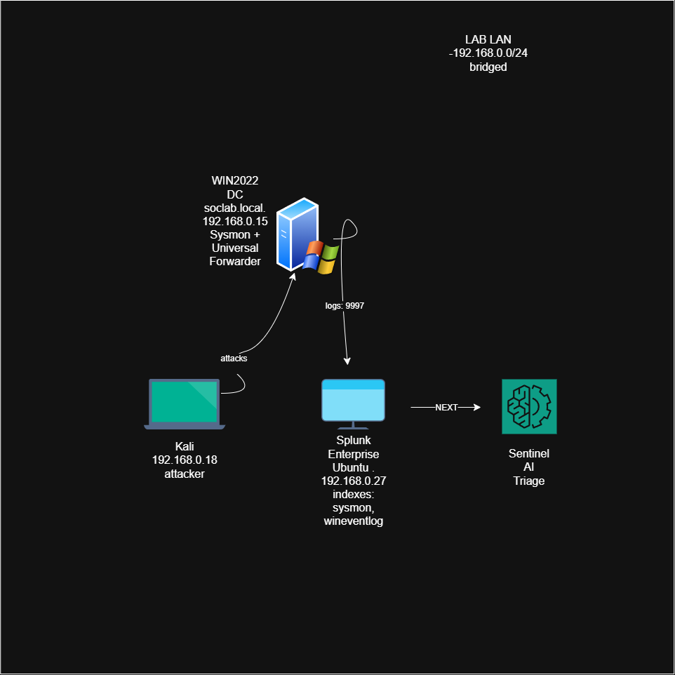

# AI-Assisted SOC Lab with Splunk

A home SOC that feeds a Windows Active Directory domain into Splunk for real-time detection, with adversary simulation from Kali and a planned AI triage layer. Built as a Splunk counterpart to my Wazuh lab — the same detection discipline, on the SIEM most UK SOC roles use.

> **Status:** Part 1 of 5 complete — logging pipeline live and validated. ~72,000 events across 49 event types from a single DC.

---

## Architecture

```
┌─────────────────────────────────┐     ┌──────────────────────────────────┐
│   Desktop PC                    │     │   IdeaPad (VirtualBox)           │
│                                 │     │   Windows Server 2022            │
│   Splunk Enterprise (Ubuntu)    │     │   Domain Controller              │
│   IP: 192.168.0.27              │     │   soclab.local                   │
│   • indexes: sysmon, wineventlog│◄────│   IP: 192.168.0.15               │
│                                 │ 9997│   • Sysmon (SwiftOnSecurity)     │
│   Kali (attacker)               │     │   • Splunk Universal Forwarder   │
│   IP: 192.168.0.18 ─────attacks─┼────►│   • T0 / T1 / T2 OU structure    │
└─────────────────────────────────┘     └──────────────────────────────────┘
              │                                        │
              └──────────── 192.168.0.0/24 ────────────┘
                      Bridged LAN (two machines)

   Splunk ──► SENTINEL (AI triage) — planned, Part 4
```



---

## Lab Components

| Component | Details |
|---|---|
| SIEM Server | Ubuntu — Splunk Enterprise, `sysmon` + `wineventlog` indexes |
| Domain Controller | Windows Server 2022 — VirtualBox, `soclab.local` |
| Endpoint telemetry | Sysmon (SwiftOnSecurity config) + Splunk Universal Forwarder |
| Attacker | Kali Linux — bridged to the lab LAN |
| Identities | 62 accounts — tiered admin model, 50 staff across 6 departments |

---

## At a Glance

| Metric | Value |
|---|---|
| Events ingested | ~72,000 |
| Distinct event types | 49 |
| Hosts monitored | 1 domain controller |
| Accounts modelled | 62 (Tier 0 / Tier 1 / Tier 2) |

---

## Project Phases

- [x] Part 1 — Logging pipeline: AD → Sysmon → Splunk, validated
- [ ] Part 2 — Adversary simulation from Kali (password spray, Kerberoasting, lateral movement)
- [ ] Part 3 — Detection engineering: SPL detections, detection rate and MTTD
- [ ] Part 4 — AI triage (SENTINEL): alert triage, MITRE ATT&CK mapping, human-approved response
- [ ] Part 5 — Wrap-up: full metrics and reproducible build notes

---

## Validation

End-to-end proof the pipeline captures and surfaces real activity.

| Screenshot | What it shows |
|---|---|
| `screenshots/pipeline-scale.png` | ~72,000 events across 49 event types from one DC |
| `screenshots/eventcode-reconciliation.png` | Account-creation burst (4720/4722/4724/4728) reconciled against the 62 accounts built |
| `screenshots/fakeuser-4625.png` | A failed logon (Event ID 4625) detected end to end in seconds |
| `screenshots/whoami-sysmon.png` | Live process execution captured by Sysmon (Event ID 1) |

---

## Debugging Log

The part that taught me the most. Each of these failed silently — no error, just missing data.

**1. Zero events for two days — a 7-hour clock drift.** The DC's clock was 7 hours ahead, so every event was stamped outside my search window. Fixed by syncing the DC to an external time source. *Lesson: if your clocks disagree, your incident timeline is fiction.*

**2. "Connected" but sending nothing — a malformed `inputs.conf`.** The forwarder showed an established connection, but its input stanzas had been written as a single line with literal escape characters instead of real line breaks, so Splunk ignored them. *Lesson: verify the data, not the status light.*

**3. Live events buried under a backlog.** When logs finally flowed, the forwarder read months of old Security events first, burying live test events. Fixed with `current_only`. *Lesson: understand how your tooling backfills before you trust what you see.*

**4. Event-count half-match — an open question.** Account-enable (4722) and password-reset (4724) events arrived at roughly half the expected count, while account-creation (4720) matched exactly. Flagged as an open item: forwarder timing vs. a Windows bulk-auditing behaviour. *Lesson: reconcile the numbers, and flag what doesn't add up.*

---

## Key Security Concepts Demonstrated

- **End-to-end log pipeline** — endpoint telemetry collected, forwarded, indexed and searchable in a SIEM
- **Sysmon detection engineering** — high-fidelity process, network and file telemetry beyond default Windows logging
- **Tiered Administration Model** — T0/T1/T2 privilege separation, carried over from the AD/Wazuh lab
- **Data validation and reconciliation** — confirming logged events match real activity, and investigating when they don't
- **Time synchronisation** — why accurate clocks underpin every incident timeline

## Part 2 — Adversary Simulation & Detection

Full write-up: [PART2.md](PART2.md) — attack chain, detections, and control-validation results.
